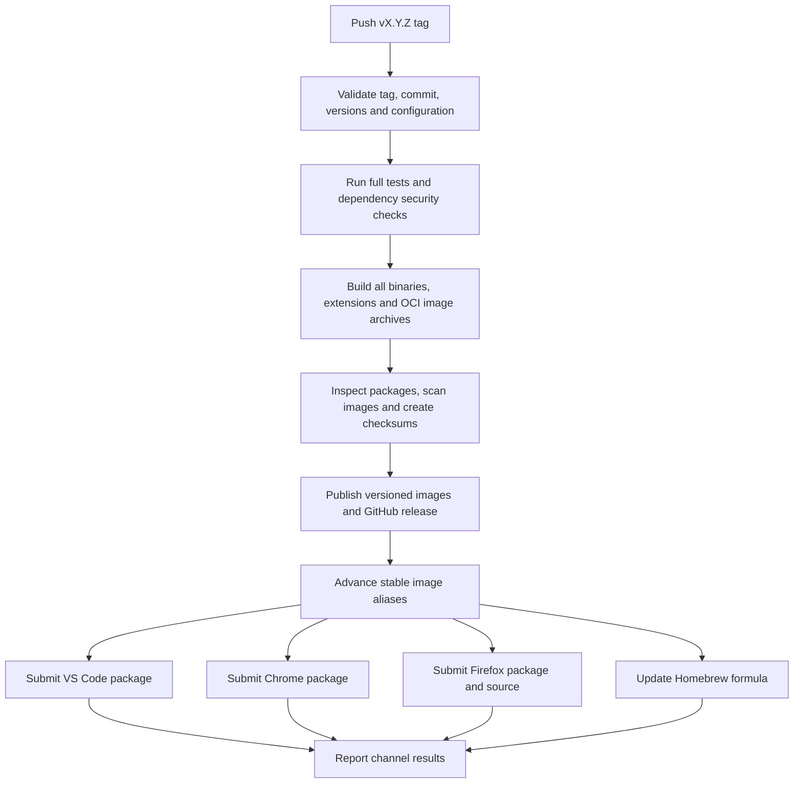

# Coordinated releases

Status: proposed workflow design. The agreed versioning policy is one tag for all
four products. The automation described below still needs to be implemented;
the existing workflow does not yet provide these guarantees.

## Maintainer workflow

Use one annotated tag, `vMAJOR.MINOR.PATCH`, to release Snipo, Snippy, the VS Code
extension, and both browser extensions from the same commit. Start with
`v2.0.0`, provided that version is higher than every published store version.
Patch releases use the same process and rebuild all products, including those
whose source did not change. Do not introduce component release tags.

1. Prepare a release PR: resolve security findings, synchronize product versions,
   update release notes and upgrade instructions, and run the release checks.
2. Merge it into `main`. Run the manual preview against the merged commit to
   inspect the packages without publishing anything.
3. Push one annotated tag on that exact commit. Actions runs the checks again,
   builds the packages, and publishes them automatically when all gates pass.
4. Read the release summary for links and each distribution channel's status.
   Retry a failed channel using the same release artifacts.

The intended command sequence, once the automation is implemented:

```bash
# In the release PR; the script accepts the version WITHOUT a leading v.
./scripts/bump-version.sh 2.0.0
git diff
# Commit the version and release-note changes, then merge the PR.

# On the clean, merged release commit:
git switch main
git pull --ff-only origin main
# Run the Actions preview for this commit and inspect its artifacts first.
git tag -a v2.0.0 -m "Snipo ecosystem 2.0.0"
git push origin v2.0.0
```

No version commits are made by the tag workflow. A tag selects reviewed source;
it must not cause dependency upgrades or silent edits to package versions.

## Version policy

The tag is the release identity; its numeric part must match these committed
product versions before a build starts:

| Product | Version locations |
|---|---|
| Snipo | `internal/version/version.go` |
| Snippy | `tui/cmd/snippy/main.go` |
| Browser extension | `extension/package.json`, `extension/manifest.json`, `extension/manifest-chrome.json` |
| VS Code extension | `vscode-extension/package.json` |

Synchronize the corresponding workspace entries in the root `package-lock.json`.
The private frontend vendor package and shared API client are build dependencies;
their package versions do not have to match the product release. Their resolved
dependencies and copied frontend assets must still be committed and verified.

The bump script should validate the complete version before changing files,
accept only a numeric `X.Y.Z` without leading zeroes, and reject versions that
cannot be represented in both browser manifests. Validate browser-specific
numeric limits too. Update JSON structurally, update the lockfile metadata, and
provide a read-only `--check` mode. Running it twice must produce the same result.

For the first implementation, support stable tags only. Reject prerelease and
build metadata suffixes rather than assigning incompatible versions to stores.
Use the preview mode for testing. Add release-candidate tags later only with an
explicit mapping for browser and VS Code versions and no stable-channel updates.

Product versioning also needs an explicit Go distribution decision. The root
and TUI currently have unsuffixed module paths, and TUI has a local `replace`
directive. A binary build from checkout can work, but a `v2.0.0` product tag does
not make these valid v2 Go module releases. Recommend binaries and Homebrew for
this release and replace the unverified `go install ...@latest` instructions.
Supporting versioned Go module installation requires a separate migration of
module/import paths, removal of release-incompatible replacements, and Go's
subdirectory tag convention; do not silently add those tags to this workflow.
See the [Go module version rules](https://go.dev/ref/mod#major-version-suffixes)
and [tag mapping rules](https://go.dev/ref/mod#mapping-versions-to-commits).

## Workflow structure

Keep `unified-release.yml` as the only publishing entry point. Add a reusable
`release-checks.yml` for the full validation suite so PRs, previews, and tags use
the same commands. Component CI can retain its fast, path-filtered feedback;
the release gate always checks every product at the resolved release commit.



### Entry points and validation

- `push.tags: ['v*']` selects candidate tags; a script enforces the full stable
  version syntax. GitHub's tag filter is a glob, not a SemVer validator.
- `workflow_dispatch` provides `mode: preview | retry-channel`, `ref`, and an
  optional channel. Preview resolves a branch, SHA, or tag once and produces
  downloadable Actions artifacts only. Retry requires an existing stable tag
  and a published release manifest; it does not rebuild or republish everything.
- Resolve annotated tags to the commit SHA. Require release commits to belong to
  protected `main`, validate all versions, and reject moved or conflicting tags.
  Tag creation is the authorization to publish. Limit who can create `v*` tags
  and prohibit tag updates and deletion using a repository ruleset.
- Pass the resolved SHA and validated version as job outputs. Every checkout,
  image label, linker flag, release record, and retry must use those outputs.
  Never use the dispatch run's `github.sha` as the selected target commit.
- Use a single publishing concurrency group with `cancel-in-progress: false`.
  Before advancing aliases, verify the release is newer than the current stable
  version; rerunning an older release must not downgrade `latest` or Homebrew.
- Preflight the required channel configuration before publication. Missing
  credentials fail clearly. Optional channels must be explicitly disabled in
  repository configuration, with that status visible in the release summary.

### Blocking checks

| Area | Required validation |
|---|---|
| Go server and TUI | Module verification, tests with the race detector, lint, and `govulncheck` in both modules |
| JavaScript workspaces | Root `npm ci`, shared client build, and audit of all workspace dependencies, including build tools |
| Vendored frontend | Regenerate from the lockfile with `packages/frontend-vendor/sync-vendor.js`; fail if committed vendor assets differ |
| VS Code | TypeScript compile, extension tests under Xvfb, production bundle, and packaged VSIX inspection |
| Browsers | Manifest validation and version checks, Firefox `web-ext lint`, Chrome smoke tests against the built Chrome package, and Firefox package smoke testing |
| Containers | Build and scan standard and hardened images for both supported architectures; check version output and health on supported runners |
| Artifacts | Required files present, expected internal versions, no credentials or unrelated build output, complete Firefox source, SHA-256 checksums |

Block on reachable Go vulnerabilities and high/critical npm or container
findings. Retain reports for lower-severity and non-reachable findings for
review. Any accepted exception must name the advisory, affected package, reason,
owner, and expiry; scanner errors or unavailable advisory databases are failures.
Pin scanner/tool versions, refresh advisory data per run, and record the scan
time. This design is not a vulnerability inventory or evidence that the current
dependencies are clean; audit and remediation are part of preparing the PR.

Release builds consume committed dependency locks; they must not run `go mod
tidy`, `npm update`, or unpinned `npx` downloads. Verify the checkout stays clean
after dependency installation and vendor synchronization. Use one supported
Node LTS version across the JavaScript jobs, pin packaging tools in the workspace
lockfile, and select Go from each module's `go.mod`. Maintain Actions pins and
the existing action lock/Sanad policy together.

### Build and publication contract

Build the server for Linux amd64/arm64, and Snippy for Linux/macOS/Windows on
amd64/arm64, retaining its Linux deb/rpm packages. Include licenses, the server's
OpenAPI file, versioned artifact names, and one unambiguous checksum manifest.
Use GoReleaser for Snippy packaging, but publish the Homebrew formula in its own
job after the unified GitHub release exists. Formula URLs must use `vX.Y.Z`,
not the historic `snippy-vX.Y.Z` prefix.

Build each image into an OCI archive, scan that archive, then publish the tested
image content without rebuilding. Preserve and verify image digests while
assembling the multiarchitecture indexes. Both image variants are required for
the initial release. Do not advance any stable alias until both versioned
images and the complete GitHub release are available.

Use explicit container tags `X.Y.Z` and `X.Y.Z-hardened`, then `latest` and
`latest-hardened`. Initially omit moving major/minor aliases to keep the policy
simple. Preview mode performs no registry writes or alias updates.

Package the VSIX and browser ZIPs once. Downstream jobs consume those exact
packages. The Firefox source ZIP must also contain the shared API-client source,
workspace manifests, root lockfile, build script, and build instructions with
tool versions. Rebuild it in a clean directory to verify that reviewers can
reproduce the submitted bundle. A ZIP is a submission artifact; advertise a
Firefox XPI as installable only after Mozilla has signed it.

Create a draft GitHub release, upload the complete verified asset set and release
manifest, then publish it. Create checksums and the manifest before finalizing;
do not depend on changing release assets after publication. Release notes come
from the maintained changelog plus generated commit notes and include upgrade
steps and the server/client compatibility matrix.

The manifest records the tag, commit SHA, product versions, asset hashes, image
digests, tool versions, and scan provenance. Channel status is separate mutable
state in the Actions summary and, if desired, release-body text. Distinguish
`disabled`, `failed`, `submitted`, `under review`, and `available` rather than
treating an accepted upload as a completed rollout.

### Store submission and credentials

| Destination | Configuration | Action after the release exists |
|---|---|---|
| GHCR / GitHub | Job-scoped `GITHUB_TOKEN` permissions | Publish tested image contents and release assets |
| Hardened image base | `DHI_USERNAME`, `DHI_API_KEY` if required | Authenticate for the hardened build |
| VS Code | Existing publisher `muhammadelashri`; publishing identity or scoped token | Publish the existing VSIX |
| Chrome Web Store | Existing publisher/item IDs and service-account or OAuth credentials | Upload the exact Chrome ZIP, then submit for review |
| Firefox Add-ons | Existing Gecko ID, `AMO_JWT_ISSUER`, `AMO_JWT_SECRET` | Submit the built Firefox directory matching the ZIP and the complete source ZIP to the listed channel |
| Homebrew | `TAP_GITHUB_TOKEN` restricted to `homebrew-snippy` | Update the formula using published artifact URLs and checksums |

Keep credentials in repository/environment secrets and pass them through
environment variables, never inline workflow expressions in shell commands.
Test/build jobs receive no store credentials. Grant write permissions only to
the jobs that need them. Preview skips publishing jobs and does not receive
publishing secrets. Normal tag publication requires no additional manual click.

Verify store accounts, extension IDs, current published versions, and credential
validity during initial setup. Chrome's API can submit an existing item for
review, but first-time listing/privacy setup requires the dashboard; review
timing is external to Actions. See the
[Chrome publishing API](https://developer.chrome.com/docs/webstore/using-api).
Mozilla supports listed submission and source upload through `web-ext`; follow
its [submission guidance](https://extensionworkshop.com/documentation/develop/getting-started-with-web-ext/)
and [source requirements](https://extensionworkshop.com/documentation/publish/source-code-submission/).
For VS Code, use the current
[publishing guidance](https://code.visualstudio.com/api/working-with-extensions/publishing-extension)
to choose authentication; it recommends Microsoft Entra ID and announces
retirement of global Azure DevOps PATs on December 1, 2026. Do not assume the
existing `VSCE_PAT` is a permanent solution.

### Recovery

Publication across GitHub, registries, and stores cannot be atomic. A failure
after publication leaves already-published destinations in place and marks the
failed channel clearly. Independent channel jobs must still run when a sibling
fails, and the final summary must run even on failure.

Retry checks the remote version/submission state first. Skip an already accepted
identical upload, report a pending review, or retry the failed operation. If the
same version has conflicting content, fail and prepare a new patch release.
Downloads must match the original manifest hashes; never overwrite published
assets, force-move tags, or silently rebuild an artifact for a retry. Image
digests are read from the same manifest. If failure occurred before the release
was finalized, resume using retained build artifacts; if those are unavailable,
start a new patch release rather than claiming replacement bytes are identical.

A store review can outlive a runner: record the submission ID and finish with
`under review`, then query status on retry without resubmitting. Reverting a
server image does not undo database migrations. Document a restore procedure
using a pre-upgrade database backup, data files, and encryption/session secrets.

## Implementation and first-release checklist

1. Fix version preparation and add version validation. Correct the existing
   development instructions that pass `vX.Y.Z` to the bump script. Add the missing
   browser package/lockfile synchronization.
2. Extract release checks and wire them into PR, preview, and tag runs. Fix the
   browser test fixture to load `dist/chrome` with its Chrome manifest; it
   currently loads the Firefox-oriented source directory while expecting a
   service worker. Add Firefox package validation and smoke coverage.
3. Correct Firefox source packaging and verify a clean rebuild. Pin Node and
   packaging tools. Remove mutable dependency-preparation hooks from release
   builds and correct Homebrew's old tag URL.
4. Implement build/scan/assemble/publish stages and separate retryable channel
   jobs. Require Docker success before completing the GitHub release; currently
   its publication runs independently and is not a dependency of that release.
5. Configure credentials, enabled channels, and tag rules. Resolve the Go module
   installation policy and document it before tagging.
6. Prepare the 2.0.0 security PR using fresh Go/npm/container reports. Review
   security changes since each product's last actual distribution, not just
   the last server tag. Update both the main and VS Code changelogs. Verify
   upgrades from the last server release on a disposable copy of a real backup,
   and test clients while store updates are still pending.
7. Run a merged-commit preview and install/test every package. Deliberately test
   a version mismatch, a failing scan, missing credentials, an older-tag retry,
   and a failed store submission. Verify preview publishes nothing and failed
   gates cannot advance stable aliases. Then push `v2.0.0` once.

GitHub documents tag-trigger behavior and dispatch contexts in
[workflow events](https://docs.github.com/en/actions/reference/workflows-and-actions/events-that-trigger-workflows).
Explicitly resolve the selected ref rather than relying on the dispatch context.
